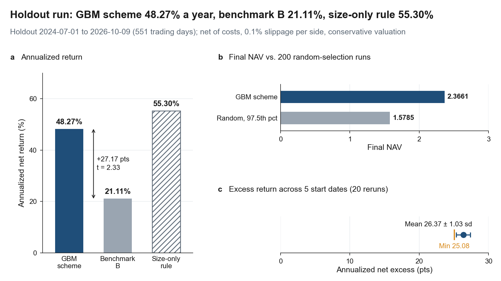

# Short-Horizon Stock Selection on China A-Shares

This repo tests a stock-selection model on China A-share main-board stocks with a blind holdout. The data were split before any design work, a gradient-boosted model that holds 50 stocks was fixed, and the 551-trading-day holdout (2024-07 to 2026-10) was then evaluated once. After commissions, stamp duty and slippage the GBM scheme returned 48.3% a year, against 21.1% for buying the whole stock pool in equal amounts on the first day and holding it (t = 2.33 on the daily return difference).

The same holdout shows where the return comes from. Holding small, thinly traded stocks accounts for 67–70% of the scheme's gross excess over an equal-weight portfolio of the pool, and a rule that holds the 50 smallest stocks, run in the same engine with the same costs, returned 55.3% a year. Selection within those buckets contributes 3.2 to 6.7 basis points a day, depending on how the buckets are drawn.

Two earlier studies are also here: a signal that ranks stocks by the chance of a joint event (the price reaches +5% within ten trading days without ever touching -5%), and a comparison of cross-sectional ranking models (Ridge, gradient-boosted trees, a neural network and LambdaMART).



---

## 1. Blind holdout test

Question: does a gradient-boosted model that holds 50 stocks beat an equal-weight buy-and-hold of the stock pool after trading costs? The study uses the main-board daily panel; its code and outputs are in `blind_holdout/`. The comparison throughout is benchmark B, the equal-weight buy-and-hold of the pool defined under Account rules below.

### 1.1 Procedure
- **Split first.** Before any design work, the panel was cut into training (2014-01-02 to 2022-12-30), selection (2023-01-03 to 2024-06-28) and holdout (2024-07-01 to 2026-10-09, 551 trading days). All design work used a truncated copy of the panel ending 2024-06-28 (export and self-check code and logs in `data_split/`).
- **Design on the training segment.** Measurements and model fitting used the training segment. The selection segment was used to test the predictions for three "cold" signals (20-day maximum daily return, 20-day volatility, a four-rank composite) and then to check the gradient-boosted composite before the holdout; on it the GBM scheme returned 5.61% a year against −9.80% for benchmark B (*t* = 1.40 over 359 days, max drawdown 36.93% against 29.29%; `design/gbm_account_backtest/out_account_v2_main.txt`). The design work ran in stages, from training-segment base rates and the backtest engine, through the cold signals, to the gradient-boosted composite and its trade-by-trade account; the scripts and outputs of each step are in their own folder under `design/`, listed folder by folder under Repository layout.
- **Fix the scheme, then run the holdout once.** The GBM scheme (version 2): a `HistGradientBoostingRegressor` on 30 daily price/volume features, fitted on 2015–2019 signal days; hold 50 stocks equally weighted, at most 5 swaps per day; plus two mechanical exclusions, X1 (ST status on any day from *t*−60 to *t*) and X2 (unadjusted close below 1 CNY on any day from *t*−20 to *t*) (`design/gbm_model_fit/`, `design/gbm_account_backtest/`). Version 2 came out of the design-stage account backtest, where 13 positions were still held when the stock's price series ended and were carried at the last close (`design/gbm_account_backtest/out_ended_series_positions.txt`): positions whose price series ends are valued at zero from the next day (conservative valuation), and X1 and X2 keep such stocks out at purchase. The scheme was fixed before the holdout data were used. Prefix invariance was checked first (identical daily decisions up to 2024-06-28 on truncated and full data); the holdout was then run once (`holdout_run/logs/run2_prefix_check_fullpre.txt`, `holdout_run/logs/run4_prefix_check_full.txt`).
- **Analyses after the holdout run**, also in `design/`: `design/return_attribution/` (full-length panel build and check, model scores on the full panel, and the decomposition of the holdout excess in 1.3), `design/size_only_rule/` (the size-only rule of 1.3 as one continuous account from 2015 to 2026-10-09, read year by year against benchmark B), `design/model_diagnostics/` (diagnostics of the default boosted tree: its assumptions against the panel's properties, time variation of feature relations, early stopping, label tails and market regimes on training rows, and a descriptive comparison over the validation, selection and holdout windows).
- **Account rules:** one 500,000 CNY long-only account; decision at close *t*, execution at the open of *t*+1; board lots; commission, transfer fee and stamp duty at actual rates, 0.1% slippage per side. Benchmark B: equal-weight buy-and-hold of the stock pool of the day before the window, after the X1/X2 exclusions (2,831 stocks for the holdout), bought at the first executable open and valued the same conservative way.

### 1.2 Holdout result

Source: `holdout_run/gbm_account_backtest/out_account_v2_full.txt`, `holdout_run/gbm_account_backtest/out_account_v2_full_perturb.txt`, `holdout_run/gbm_account_backtest/out_account_v2_full_random.txt` (conservative valuation, main cost setting).

Over the 551-day holdout the GBM scheme met four of the five targets:

| Target | Requirement | Holdout | Result |
|---|---|---|---|
| 1 Magnitude | annualised net return ≥ benchmark B + 5 pts | 48.27% vs. 21.11%, +27.17 pts | pass |
| 2 Significance | ordinary *t* of daily return difference ≥ 2 | *t* = 2.33 (551 days) | pass |
| 3 Drawdown | max drawdown ≤ benchmark B | 29.45% vs. 23.09% | not met |
| 4 Selection vs. random | final NAV > 97.5th pct of 200 random-selection runs | 2.3661 vs. 1.5785 | pass |
| 5 Stability | 20 reruns (start shifted by 0–4 days × 4 seeds of score noise): min > 0, sd ≤ mean/3 | min 25.08, mean 26.37, sd 1.03; the seeds gave identical runs, so 5 distinct values | pass |

### 1.3 Sources of return

Source: `design/return_attribution/out_attribution_main.txt`.

- Measured against an equal-weight portfolio of the whole pool, the holdout gross excess was 10.93 bp/day. Holding the smallest, least-traded stocks explains **39%** of it when bucketing by turnover amount alone, and **67%–70%** when bucketing by turnover amount and market cap together. The remaining within-bucket selection is 3.2–6.7 bp/day (*t* 1.85–2.8).
- The size-only rule ("hold the 50 smallest by a market-cap proxy, at most 5 swaps per day, same exclusions"), run in the same engine with the same costs, is reported alongside: 55.30% annualised with a 20.76% max drawdown in the holdout.

### 1.4 Forward tracking and data
- Sensitivity accounts on the holdout: with 0.02% slippage per side the GBM scheme returned 54.24% a year against 21.15% for benchmark B, and a 20,000 CNY account returned −16.40% against 20.63%. These and the quarterly results are in `holdout_run/gbm_account_backtest/out_account_v2_full.txt`.
- Forward tracking, segment 1 (2026-10-12 to 2026-11-09, 21 trading days): −0.42 points vs. benchmark B and +1.74 points vs. the size-only rule (`forward/gbm_account_backtest/out_forward_tracking_fwd1.txt`).
- The scripts use placeholders such as `<BLIND_ROOT>` / `<DATA_ROOT>` in place of the original paths.

## 2. Earlier study: joint-event signal

This study asks three questions:

1. Can a causal 12-feature description of each stock (momentum, volatility, liquidity) rank A-share main-board stocks by the probability of a **joint event** within a short holding window: the daily high reaches +5% of the entry open while the daily low never touches -5%?
2. After removing overlapping signal windows of the same stock, how much upside, how much drawdown, and how quickly does the typical selected event move?
3. Over a 15-trading-day horizon, how do the joint-event selections compare with an earnings-announcement-return (EAR) event rule on the same days?

### 2.1 Features
Code: `src/ashare_strategy/features/math12.py`.
Twelve causal features, each using information up to the close of day *t*:
momentum (`log_return_5d`, `log_return_21d`, `log_return_5_to_63d`, `log_return_21_to_252d`, `maximum_return_21d`),
volatility (`return_volatility_20d`, `return_volatility_252d`, `market_residual_volatility_60d` vs. CSI 300, `intraday_range_mean_20d`),
liquidity (`log_amihud_20d`, `log_amount_median_20d`, `log_volume_median20_to_median120`).
Cross-sectionally they are winsorised at 1%/99% and rank-mapped to [-1, 1].

### 2.2 Joint-event label
Code: `scripts/research/build_short_w_joint_inputs.py` (`joint_labels`).
For each stock/origin, starting from the scheduled entry day's adjusted open, over a window W of at most 10 trading days (and at most 14 calendar days) each day is assigned a cumulative state:
`0` neither, `1` high ≥ 1.05 × open (up only), `2` low ≤ 0.95 × open (down only), `3` both.
The "clean" joint event is ending the window in state `1`: +5% reached and -5% never touched. Same-bar up/down order is treated as unknown.

### 2.3 State-transition likelihood model
Code: `scripts/research/short_w_joint_model.py`.
- `JointObjective` (110 parameters = 5 transitions × (10 day offsets + 12 feature coefficients)): from state 0 a multinomial logit over {0,1,2,3}; from states 1 and 2 a logistic hazard into state 3; state 3 is absorbing. Fitted by penalised weighted likelihood over observed daily paths.
- `predict` marginalises the path to give state probabilities at every day of W; `ReductionObjective` (13 parameters) is a logistic control on the final clean event.
- `select` takes the top 4 names per day.
- Data periods: the buy model was fixed on data up to 2021-06 (`results/joint_event/fixed_category_window_report.md`); 2023–2026 data were also used during development.

### 2.4 Overlap removal
Code: `scripts/research/build_short_w_joint_dedup.py` (`membership`).
Per stock, the earliest signal is kept; a later signal is kept only if its scheduled entry is after the end of the last kept event's window W. Dropped events do not extend windows; unfilled or unfinished events still take part in date de-duplication.

### 2.5 EAR comparison
Code: `scripts/research/compare_short_joint_h15_ear_matched_opportunity.py`.
EAR is an event rule (definition in `scripts/research/short_joint_h15_ear_finite_history_compiler.py`, `score_event` / `threshold_for` / `daily_buy_candidates`): the stock's compound return from the close two sessions before the first post-announcement reaction session to the close one session after it, minus the CSI 300 return over the same four closes. A stock qualifies if EAR > 0 and above the previous quarter's 80th percentile; at most 4 names per day by EAR.
The comparison pairs EAR selections with the joint-model top-4 on the same signal days, each day weighted once, over H = 5/10/15 trading days, measuring post-entry maximum favourable excursion (MFE, upside) and maximum adverse excursion (MAE, drawdown).

### 2.6 Overlap removal results
Source: `results/joint_event/dedup_comparison.md`.
- 3524 raw events → 1242 kept, 2282 overlapping events removed; 596 stocks before and after.
- Full window 2023-01-01—2026-08-21: 3403 of the 3524 raw events and 1198 of the 1242 kept events have a complete price path over their window W, and the gain statistics use these complete paths; mean max gain 7.77% → 7.65%; median max gain 4.89% → 5.07%; share reaching +5% 48.87% → 50.58% (606/1198).
- Max gain > 0 in 1167/1198 (97.41%); ≥ 3% 808/1198 (67.45%); ≥ 10% 298/1198 (24.87%); excluding the entry day, 1040/1198 (86.81%) later traded above the entry reference.
- Same full window: median first-peak day 5.00 → 4.00; pre-peak low mean -2.82% → -2.91%, median -2.23% → -2.31%; 142/896 determinable events fell at least 5% before the peak; full-window low median -4.72% → -4.88%.
- `results/joint_event/fixed_category_window_report.md`, period `2023-01-01—2026-08-21`: full-window max drawdown mean/median 6.24%/4.88%.

### 2.7 Joint model vs. EAR at H = 15
Source: `results/joint_event/ear_matched_opportunity_h15_report.md`.
Same-day comparison over all signal days, each origin weighted equally (percentage points; Δ = EAR selections minus joint-model selections, both drawn from the same common pool; MAE more negative = deeper drawdown; day1 MFE is measured from the entry day to H, day2+ MFE from the second day to H):

| Period | H | N | Δday1 MFE | Δday2+ MFE | ΔMAE |
|---|---:|---:|---:|---:|---:|
| 2023 | 15 | 91/91/91 | 2.077 | 1.838 | -1.385 |
| Sep 2021 – Dec 2022 | 15 | 139/139/139 | 1.998 | 1.737 | -1.107 |

On these 91 paired 2023 signal days, the EAR selections had larger upside and deeper drawdown. Neither selection dominates the other: the two trade upside against drawdown, with the same pattern in the Sep 2021 – Dec 2022 window. In the quarter 2023Q4, N = 14, Δday2+ MFE -0.284, ΔMAE -4.159: in that quarter the EAR selections had both lower upside and deeper drawdown.

## 3. Earlier study: model comparisons

Question: on a cross-sectional 5-day return panel, do Ridge, gradient-boosted trees (HGB / LightGBM with three label forms), a GKX-style NN3 network, or LambdaMART rank stocks better?

### 3.1 Setup
All on a 2014-01-02 to 2026-08-21 main-board development panel with a separate 108-column feature set (not the 12 features of section 2), 5-day trade-return label, models trained once on labels matured before 2022-01-01 and evaluated 2022-01-04 to 2026-08-21:
- Ridge vs. HGB and their z-score ensemble: `scripts/research/ml_ensemble_fixed.py`
- LightGBM with return-MSE, cross-sectional-rank and up/down binary labels: `scripts/research/label_form.py`
- GKX NN3 (108→32→16→8→1) vs. Ridge: `scripts/research/ashare_fixed_nn3.py`
- LambdaMART (LightGBM `LGBMRanker`): `experiments/experiment_stockranker_lambdamart.py` (separate window; see 3.2)

Shared engine/rule modules: `ashare_engine.py`, `ashare_daily_judgment.py`, `ashare_ml_signals.py`, `ashare_rules_lib.py`, `ashare_cost_aware_exit.py`.

Rank IC below is the mean daily Spearman correlation between a model's score and the realised 5-day return.

### 3.2 Results
- **Ridge vs. HGB vs. ensemble** (source: `docs/model_comparison/ml_ensemble_fixed.md`). The ensemble is the daily average of the two models' cross-sectional z-scores. In a 500,000 CNY account holding 10 stocks, which buys stocks whose score is above 1%, annualised return divided by max drawdown was 0.579 for the ensemble, 0.497 for Ridge and −0.137 for HGB. Year by year over 2022–2026, the ensemble's rank IC was above both components in one year, 2023. Over 2022–2026 as a whole, rank IC was 0.0823 for Ridge, 0.0677 for HGB and 0.0820 for the ensemble.
- **LightGBM label forms** (source: `results/model_comparison/label_form_criterion.json`, `docs/model_comparison/label_form.md`). The cross-sectional-rank label and the up/down binary label were each compared with the return-MSE label over five periods (the years 2022–2025 and 2026 to 08-21). The rank label had the higher ratio of annual return to within-year max drawdown in 4 of the 5 periods and the higher rank IC in all 5; the binary label had the higher ratio in none of the 5 periods and the higher rank IC in 1. The accounts behind these ratios use a rank band: 500,000 CNY holding 10 stocks, a stock is bought when it enters the day's top 10% by score and sold when it drops out of the top 50%. In this rank-band account the rank label returned 21.59% a year with a 27.03% max drawdown and -10.42% over the last 12 months; the return-MSE label returned 9.03% a year with a 50.82% max drawdown; fixed Ridge returned 21.31% with 38.13%.
- **NN3 vs. Ridge** (source: `results/model_comparison/nn3_criterion.json`). Over ten start dates of a 500,000 CNY account holding 10 stocks, the median annualised return divided by the median max drawdown was -0.1627 for NN3 and 0.4893 for Ridge. NN3 had a higher rank IC than Ridge in 0 of the 5 years 2022–2026.
- **LambdaMART** (source: `results/model_comparison/lambdamart_20260601_20260703_summary.md`). Train 2025-04-01 to 2026-05-29, test 2026-06-01 to 2026-07-03; daily RankIC mean 0.0258, ICIR 0.1365; top-2 portfolio total return 0.2292, max drawdown -0.0852.

## 4. Data sources

- Daily A-share bars (open/high/low/close, volume, amount, adjustment factors) and the CSI 300 index were collected from **Baostock** and **AkShare** (see `requirements.txt`).
- The EAR comparison additionally used public listings of periodic-report announcements.
- Market data, caches, model weights, score arrays and intermediate outputs are not distributed with this repository. To obtain the data:
  - `pip install baostock akshare`
  - Baostock: `bs.login()` then `bs.query_history_k_data_plus(code, "date,open,high,low,close,volume,amount,adjustflag", start_date, end_date, frequency="d", adjustflag="2")` for forward-adjusted bars, and the same call with `adjustflag="3"` for raw prices.
  - AkShare: e.g. `ak.stock_zh_a_hist(symbol, period="daily", adjust="qfq")` and `ak.stock_zh_index_daily(symbol="sh000300")`.
  - The scripts expect these bars to be pre-assembled into the project's local cache layout (`output/research_once/...`, `research_data/...`).

## 5. Repository layout and file provenance

```
src/ashare_strategy/features/math12.py         12-feature transform
scripts/research/
  build_short_w_joint_inputs.py                  joint-event labels and inputs
  short_w_joint_model.py                         110-parameter transition likelihood + 13-parameter control
  build_short_w_joint_recent_buy_w.py            event summariser used by the dedup step
  build_short_w_joint_dedup.py                   -> results/joint_event/dedup_comparison.md
  compare_short_joint_h15_ear_matched_opportunity.py
                                                 -> results/joint_event/ear_matched_opportunity_h15_report.md
  short_joint_h15_ear_finite_history_compiler.py EAR definition
  ml_ensemble_fixed.py                           -> docs/model_comparison/ml_ensemble_fixed.md
  label_form.py                                  -> results/model_comparison/label_form_criterion.json, docs/model_comparison/label_form.md
  ashare_fixed_nn3.py                            -> results/model_comparison/nn3_criterion.json
  ashare_engine.py, ashare_daily_judgment.py, ashare_ml_signals.py,
  ashare_rules_lib.py, ashare_cost_aware_exit.py shared engine / rules
experiments/experiment_stockranker_lambdamart.py -> results/model_comparison/lambdamart_20260601_20260703_summary.md
results/joint_event/fixed_category_window_report.md   re-layout of the dedup summary (dedup_comparison.md)
blind_holdout/                                   blind holdout test (section 1)
  data_split/                                    data split: truncated export, self-check and their logs
  design/                                        scripts and outputs, one folder per step:
    base_rates/, backtest_engine/                base rates, engine
    cold_signal_cost_check/, cold_signal_measurements/,
    cold_signal_selection_check/, cold_signal_tracking_error/
                                                 cold-signal studies
    boosted_tree_measurements/                   boosted-tree measurements
    gbm_model_fit/, gbm_account_backtest/        GBM scheme
    return_attribution/                          after the holdout: attribution
    size_only_rule/                              after the holdout: size-only rule over 2015-2026
    model_diagnostics/                           after the holdout: model diagnostics
  prep/                                          data-extension scripts and arithmetic checks
  holdout_run/                                   single holdout run: scripts, outputs (gbm_account_backtest/out_account_v2_full*.txt) and logs
  forward/                                       forward-tracking scripts, outputs and segment-1 record
```

The design folders before the holdout, in `blind_holdout/design/` (`design/check_cost_threshold_tables.py`: arithmetic check of the cost and threshold tables):
- `design/base_rates/`: training-segment base rates: market volatility and drawdown, overheated states, limit-up/limit-down events, rank IC of eight generic features, market-level predictability, a zero-information placebo and board-lot sizes.
- `design/backtest_engine/`: backtest engine with synthetic tests, a prefix-invariance check and a simple limit-up indicator baseline.
- `design/cold_signal_cost_check/`: arithmetic check of the expected-drift and cost tables for a fixed-signal hold.
- `design/cold_signal_measurements/`: three "cold" signals (20-day maximum daily return, 20-day volatility, a four-rank composite): return by signal percentile, rank persistence, basket tracking error, drawdown against the buy-and-hold pool, width of the random-selection control, tradability.
- `design/cold_signal_selection_check/`: the one-time selection-segment check of the `design/cold_signal_measurements/` measurements, with a dry run on the last half-year of training rows.
- `design/cold_signal_tracking_error/`: whether the tracking error of the cold-zone set can be removed by balancing its beta, size and liquidity exposures.
- `design/boosted_tree_measurements/`: training-segment measurements for the gradient-boosted composite (fitted from the pool start to 2019, checked on 2020–2022).
- `design/gbm_model_fit/`: the gradient-boosted composite of the GBM scheme with a 50-stock quota: fit, and prefix-invariant extension to later data.
- `design/gbm_account_backtest/`: trade-by-trade account for the gradient-boosted composite (50 stocks, at most 5 swaps per day), with unit tests, prefix checks, perturbed and random-selection runs; the `account_v2` files are version 2 of the scheme.

## 6. Reproduction

The scripts read the local market-data cache and intermediate outputs in the original layout (`output/research_once/...`, `research_data/...`). Entry points, for example:

```
python scripts/research/build_short_w_joint_dedup.py ...
python scripts/research/ml_ensemble_fixed.py signals
python scripts/research/label_form.py signals
python scripts/research/ashare_fixed_nn3.py signal
```

Dependencies: `requirements.txt`, `requirements-research.lock`, `requirements-neural-research.lock`, `pyproject.toml`.

## License

MIT, see `LICENSE`.
